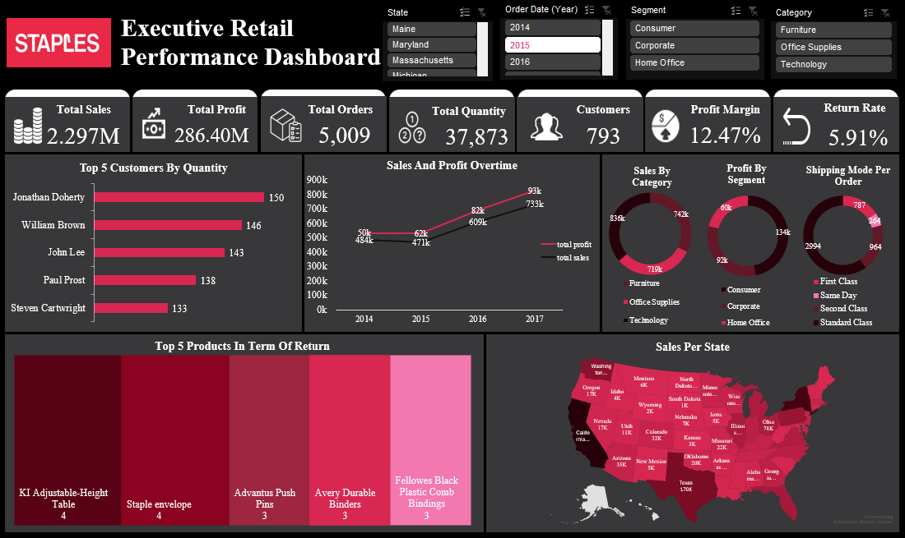

# Executive Retail Performance Dashboard (Excel)

**An interactive Excel dashboard and executive review that turns four years of retail sales data into four clear, profit-focused recommendations.**



> **Disclaimer:** This is a portfolio project built on a simulated, publicly available retail dataset. The Staples name and logo are used for illustration only. No real company data is used, and this project is not affiliated with or endorsed by Staples Inc.

---

## The Business Request

The (fictional) CEO asked the data analytics team for an interactive executive dashboard to monitor sales performance, profitability, customer behavior, product performance, and operational efficiency, and to highlight the trends, opportunities, and areas of concern that matter most.

## What I Did

- **Cleaned** the raw data in Excel (formatting, duplicates, data types, consistency checks).
- **Modeled** the data with calculated measures: total sales, profit, profit margin, orders, quantity, customers, and return rate.
- **Built** an interactive dashboard with slicers for State, Order Date (Year), Segment, and Category.
- **Analyzed** the results to find what is driving profit and what is quietly draining it.
- **Presented** the findings and recommendations to leadership in an executive deck.

**Tools:** Microsoft Excel (data cleaning, calculated measures, charts, slicers, dashboard design) and PowerPoint (executive presentation).

## Headline Numbers (FY 2014 to 2017)

| Total Sales | Total Profit | Profit Margin | Orders | Customers | Return Rate |
|:-:|:-:|:-:|:-:|:-:|:-:|
| $2.30M | $286K | 12.47% | 5,009 | 793 | 5.91% |

## Key Insights

1. **The business is growing.** Sales rose 51% and profit rose 89% from 2014 to 2017, with growth in every year.
2. **Furniture is the weak spot.** It generates $742K in sales (nearly a third of the total) but earns only a 2.5% margin. Tables (-8.6%) and Bookcases (-3.0%) lose money outright, while Technology and Office Supplies each earn about 17%.
3. **Deep discounts destroy profit.** Full-price orders earn about a 30% margin, but orders discounted more than 20% lose money, costing an estimated **$135K**.
4. **Four big states lose money.** Texas, Ohio, Pennsylvania, and Illinois all rank in the top 10 for sales yet post a net loss, roughly **$71K combined**, likely tied to the same discounting pattern.
5. **Returns are not a problem.** A 5.9% return rate is healthy for retail.

## Recommendations

| # | Recommendation | Why |
|:-:|---|---|
| 1 | **Cap discounts at 20%** and require manager approval above that | The biggest single lever; targets the ~$135K lost to deep discounting |
| 2 | **Fix or phase out Tables and Bookcases** (renegotiate supplier costs, raise prices, or trim the assortment) | The rest of Furniture is healthy; the problem is concentrated in two lines |
| 3 | **Audit discounting in TX, OH, PA, and IL** | These states show the same loss pattern as the deep-discount tiers |
| 4 | **Double down on Technology and Office Supplies** | They generate about two-thirds of company profit at roughly 17% margins |

Fixing discount discipline and two underperforming product lines could meaningfully lift the 12.5% margin without needing a single new customer.

## Dashboard Design

The dashboard was laid out for a CEO audience: KPI cards at the top for a 5-second health check, then trends, category and segment breakdowns, and a geographic view below. The slicers let executives explore performance by time, customer segment, product category, and state.

**Visuals included:** KPI cards, sales and profit over time, sales by category, profit by segment, shipping mode per order, top 5 customers by quantity, top 5 products by returns, and sales per state (map).

## Repository Structure

```
├── README.md
├── data/
│   ├── raw/          # original dataset
│   └── cleaned/      # cleaned dataset used for the dashboard
├── dashboard/
│   ├── Executive Retail Dashboard.xlsx
│   └── dashboard preview.png
├── report/
│   └── Staples Executive Presentation.pptx
└── docs/
    └── CEO Email.pdf
```

## How to Use

1. Download `dashboard/Executive Retail Dashboard.xlsx` and open it in Microsoft Excel.
2. Use the slicers at the top (State, Year, Segment, Category) to filter every chart at once.
3. Read the full story and recommendations in the presentation inside the `report/` folder.

## About Me

**Claudia Al-Amir** | Data Analyst
[LinkedIn](www.linkedin.com/in/claudia-al-amir-131199424) | [Email](claudiaalamir21@gmail.com)
